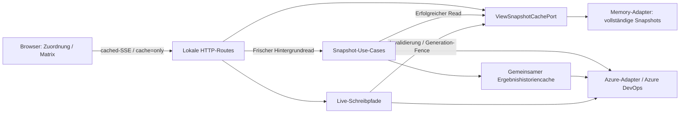

# Letzten Datenstand nach Browser-Neuladen anzeigen

## Zielverhalten

Ein Browser-Neuladen soll einen bereits erfolgreich geladenen Stand von Zuordnung oder Release-Matrix sofort wieder anzeigen. Der laufende lokale Server hält dazu begrenzte vollständige Snapshots im Arbeitsspeicher vor. Gleichzeitig startet ein frischer Azure-Read im Hintergrund. Der vorhandene Header zeigt das ursprüngliche Alter und die laufende Aktualisierung; nach einem Fehler bleibt der vorherige Stand mit Fehlermeldung sichtbar.

Die ausgewählte Ansicht bleibt über `?view=matrix` in der URL erhalten; ohne diesen Parameter öffnet sich die Zuordnung. Diese Navigation benötigt keine neue gespeicherte Präferenz. Ein direkter Einstieg in die Matrix startet keine zusätzliche, noch nie besuchte Zuordnungsansicht. Wer bereits in der Zuordnung gearbeitet hat, behält ihren bestehenden Zustand beim Ansichtswechsel.

## Grenzen

- Der Servercache bleibt flüchtig. Nach einem Neustart des lokalen Servers oder ohne passenden vorherigen Snapshot ist der erste vollständige Abruf erforderlich.
- Höchstens 16 Snapshots, zusammen höchstens 32 MiB serialisierte Daten und Schlüssel, und höchstens 30 Minuten Quellenalter. Ein Abruf aus dem Cache verjüngt weder Quellenzeit noch Ablauf.
- Matching und Matrix trennen ihre Azure-Kontexte weiterhin wie bisher: Zuordnung verwendet den globalen Kontext, Matrix den gegebenenfalls am Set gebundenen Kontext.
- Set, Plan, Root-Suite, Query und Matrix-Versionsauswahl gehören zum jeweiligen Leseschlüssel. Ein anderer Kontext oder eine andere Auswahl darf keinen alten Stand der vorherigen Auswahl anzeigen.
- Nur vollständige erfolgreiche Reads werden übernommen. Abbruch und Ladefehler ersetzen keinen gültigen Snapshot. Schreibversuche invalidieren betroffene Snapshots und sperren ältere laufende Reads gegen erneutes Einsetzen.
- Wiederhergestellte Matrix-Snapshots sind reine Anzeige während der Hintergrundaktualisierung und bestätigen keine unbestätigten Mutationen. Erst ein erfolgreicher aktueller Read darf bestehende Schreibsperren gemäß den bisherigen Regeln aufheben.
- Keine Persistenz von Laufzeitdaten in LowDB, LocalStorage oder einer zusätzlichen Browserdatenbank. Nutzerpräferenzen behalten ihre bestehende Persistenz.

## Lesepfad

Zuordnung erhält gegebenenfalls zuerst ein SSE-Ereignis `cached`, danach die bestehenden Fortschrittsereignisse und zuletzt `result` oder `error`. `cached` beendet weder Stream noch Ladezustand.

Die Matrix kann über `cache=only` ihren letzten Snapshot ohne Azure-Abfragen abrufen. Der normale Matrix-Read bleibt ein vollständiger aktueller Read. Die UI zeigt den wiederhergestellten Stand, während der normale Read parallel weiterläuft. Verspätete Cache-Antworten dürfen einen erfolgreich frisch geladenen Stand nicht überschreiben.

Der [gemeinsame Ergebnishistoriencache](shared-history-cache.md) bleibt zusätzlich aktiv. Er reduziert innerhalb seiner 60-Sekunden-Frist die Ergebnisabfragen des Hintergrundreads. Die hier beschriebenen vollständigen Snapshots überbrücken dessen Wartezeit nach einem Browser-Neuladen.

`snapshotPreviewHits` zählt den erfolgreichen Vorschauzugriff in den bestehenden Server-Diagnosen und beim Matching-SSE im Browser. Die weiterhin protokollierte Gesamtdauer bezeichnet den vollständigen Hintergrundread. Eine bereits sichtbare Vorschau beendet diese Messung nicht.

## C4: Komponenten

