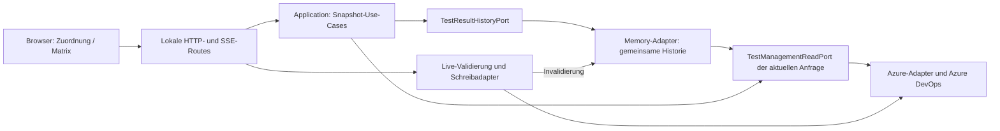

# Gemeinsame Ergebnishistorie und Alter des Datenstands

Zuordnung und Release-Matrix verwenden innerhalb desselben lokalen Servers einen gemeinsamen Historiencache. Das Ziel ist, wiederholte Abfragen aller Testlauf-Ergebnisse zu vermeiden, ohne die vollständige Historie oder die bestehende Auswahl des maßgeblichen Suite-/Testfall-Ergebnisses zu kürzen.

## Verhalten

- Jeder neue Datenabruf liest weiterhin die vollständige aktuelle Run-Liste des Plans. Neue, geänderte und laufende Runs erhalten frische Ergebnisabfragen. Gelöschte Runs verschwinden aus der gelesenen Historie.
- Abgeschlossene, anhand ihrer verfügbaren Metadaten unveränderte Runs können ihre Ergebnisse bis zu 60 Sekunden ab dem ursprünglichen Ergebnisabruf wiederverwenden. Ein Cache-Treffer verlängert diese Frist nicht. Die Grenze gilt auch bei fehlenden Änderungsmarkern; nach Ablauf werden Ergebnisse erneut gelesen. Ergebnisänderungen ohne veränderten Run-Marker können innerhalb dieser Frist noch den gespeicherten Stand zeigen.
- Ergebnisse mit widersprüchlichem explizitem State, unvollständige Antworten, Fehler und abgebrochene Gesamtreads werden nicht als neue abgeschlossene Historie übernommen. Fehlende Ergebnis-States bleiben mit der bestehenden Azure-Aggregation kompatibel.
- Der Cache liegt ausschließlich im Arbeitsspeicher: maximal acht Kontexte, 5.000 Run-Einträge und 100.000 Ergebnisse. Die Schlüssel enthalten normalisierten Azure-Kontext, Plan und Run. Browser- oder LowDB-Persistenz entsteht nicht.
- Nur fertig geladene Werte werden zwischen Anfragen geteilt. Laufende HTTP-Aufrufe behalten ihre eigene Anfrage und ihr eigenes AbortSignal; der Abbruch einer Ansicht beendet keine andere Anfrage.
- Outcome- und Reset-Schreibversuche invalidieren vor und nach dem Transport. Das gilt auch für fehlgeschlagene oder unbestätigte Writes. Generation-Fences verhindern, dass ältere laufende Reads danach veraltete Cache-Einträge wieder einsetzen. Schreibvalidierungen und Bestätigungen lesen weiterhin live.
- Sobald die erste echte Testfall-Mitgliedschaft bekannt ist, startet der Historienabruf parallel zu den übrigen Suite-/Point-Abfragen. Leere Auswahlen verursachen keine Historienabfrage.

## Header und Refresh

Während eines Refreshs bleibt der bisherige Stand derselben Ansicht und desselben Set-/Plan-/Query-/Azure-Kontexts sichtbar. Die Header-Leiste zeigt dessen Alter, anfangs sekundengenau, anschließend in Minuten, Stunden oder Tagen. Der Tooltip der Zeitangabe enthält Datum und Uhrzeit.

Bei wiederverwendeten Ergebnissen steht „Gespeicherter Stand“ neben „Datenstand vor …“. Während eines laufenden Reads erscheint „Wird aktualisiert …“. Schlägt er fehl, bleiben Daten und Zeitstempel erhalten; der Header meldet „Aktualisierung fehlgeschlagen · Alter Stand“. Die vorhandene Matrix-Sperre für Schreibzugriffe auf einen fehlgeschlagenen oder noch aktualisierten Stand bleibt aktiv. Beim Kontextwechsel werden Daten des früheren Kontexts nicht weiter angezeigt.

`loadedAt` bezeichnet den Abschluss des aktuellen Reads. Das zusätzliche optionale `freshness`-Objekt enthält `sourceReadAt` und `cacheUsed`. `sourceReadAt` ist konservativ der älteste verwendete Abrufzeitpunkt einschließlich wiederverwendeter Ergebnisse, nicht der aktuelle Cache-Hit. Der Header verwendet diesen Quellenzeitpunkt. Auch der bestehende Matrix-Navigationscache richtet seine 60-Sekunden-Frist danach aus; die beiden Cache-Stufen verlängern die Quellenfrist nicht hintereinander.

Die vorhandene Tabelle kann bis zum nächsten Refresh weiter angezeigt werden und entsprechend älter werden. Es gibt kein neues automatisches Polling. Ihr Alter bleibt im Header sichtbar. „Refresh“ liest Suites, Points, Work Items und Run-Liste erneut; innerhalb der Quellenfrist dürfen unveränderte abgeschlossene Ergebnisse wiederverwendet werden.

Auch nach einem [Browser-Neuladen wird ein vorhandener vollständiger Server-Snapshot sofort angezeigt](reload-snapshot-preview.md), während ein frischer Read im Hintergrund läuft. Die hier beschriebene 60-Sekunden-Grenze betrifft die Ergebniswiederverwendung im frischen Read; der deutlich als alt gekennzeichnete vollständige Vorschau-Snapshot hat eigene, begrenzte Aufbewahrung.

## C4: Komponenten des Lesepfads



## Nachweis und Reproduktion

Die folgenden Werte stammen aus dem vorhandenen Test-Harness mit simuliertem Azure-Transport, 15 ms Verzögerung je GET, 965 historischen Runs und einem Durchlauf je Szenario. Sie sind keine neuen Live-Ladezeiten des Windows-Rechners.

| Szenario | Azure-Anfragen | Ergebnisanfragen | Dauer |
| --- | ---: | ---: | ---: |
| Zuordnung, kalter Cache | 986 | 965 | 2.100 ms |
| Anschließend Matrix | 20 | 0 | 76 ms |
| Anschließend Zuordnung | 21 | 0 | 73 ms |
| Ein geänderter und ein neuer Run | 22 | 2 | 83 ms |
| Nach Ablauf der Quellenfrist | 986 | 966 | 2.056 ms |

```sh
node_modules/.bin/esbuild tests/performance/view-read-benchmark.ts --bundle --platform=node --format=esm --outfile=/tmp/view-read-cache.mjs
VIEW_BENCHMARK_MODE=shared-history node /tmp/view-read-cache.mjs
```

Die Rohdaten stehen danach in `/tmp/view-read-shared-history.json`. Der Ablauf prüft über dieselben echten Adapter beide Ansichten und die Wiederverwendung einer gemeinsamen Cache-Instanz. Runtime-Integrationstests prüfen zusätzlich gleiche und unterschiedliche Azure-Kontexte, Write-Invalidierung und unabhängige Consumer-Abbrüche. Browserregressionen prüfen Header-Zeitstempel, Refresh-Zwischenstände und Fehler bei erhaltenen Tabellen.

Die bestehende [Ladezeitdiagnose](view-load-diagnostics.md) bleibt aktiv. Zusätzlich zählen `historyRunsReused` und `historyRunsFetched` die Wiederverwendung beziehungsweise das tatsächliche Nachladen je Historienabruf. Der Matrix-Navigationscache kann einen kompletten Browser-Read vermeiden; dann entsteht weiterhin keine neue Servermeldung.
